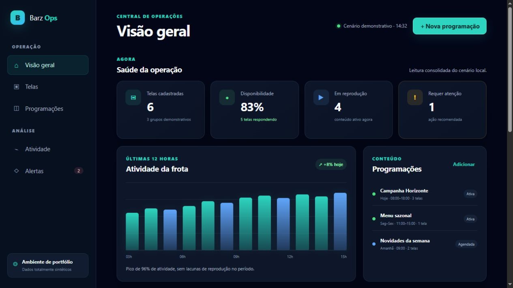
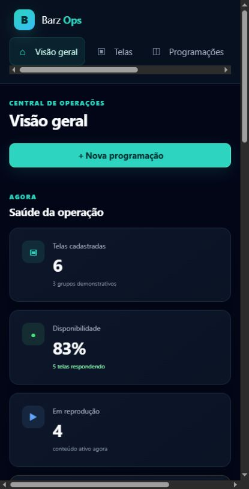

# Barz Operations — portfólio técnico

Painel operacional responsivo para acompanhar uma frota de telas, programações de conteúdo e alertas. Esta edição foi criada do zero com dados totalmente sintéticos e funciona sem servidor, dependências ou conexão de rede.

## Demonstração





As capturas acima foram geradas diretamente desta demonstração local. Elas mostram o mesmo cenário sintético em viewports desktop e mobile, sem dados de clientes ou serviços internos.

## Problema

Uma operação com várias telas precisa responder rapidamente a três perguntas: o que está online, o que está reproduzindo e onde existe uma exceção que exige ação. Misturar configuração, análise e alertas em uma única superfície aumenta o tempo de resposta e a chance de erro.

## Solução

A interface organiza o trabalho em uma hierarquia simples: saúde geral, tendência de atividade, programações, tabela pesquisável de telas e alertas recentes. Filtros combinam estado e busca textual. Uma janela de programação demonstra a interação sem enviar ou persistir dados.

## Decisões de UI/UX

- tema escuro de alto contraste para monitoramento prolongado;
- verde-água reservado para foco e ação, verde para sucesso, amarelo para atenção e rosa para falha;
- números tabulares, cartões compactos e tabela densa, porém legível;
- estados comunicados por texto, forma e cor;
- navegação por teclado, foco visível, região `aria-live`, link de salto e movimento reduzido;
- layout responsivo para desktop, tablet e celular;
- gráfico com resumo textual e valores acessíveis.

## Arquitetura

- `index.html`: estrutura semântica e componentes;
- `styles.css`: tokens, layout, responsividade e acessibilidade;
- `demo-data.js`: cenário sintético explícito;
- `app.js`: métricas, filtros, renderização e interação somente em memória;
- `tests/`: contratos de conteúdo, segurança local e lógica.

## Como executar

Abra `index.html` diretamente no navegador ou use um servidor estático local:

```bash
python -m http.server 8080
```

Depois acesse `http://127.0.0.1:8080`. Para validar:

```bash
npm test
```

## Segurança e privacidade

Não há `fetch`, WebSocket, armazenamento do navegador, autenticação, banco, API, endereço interno ou dado de cliente. Nenhuma ação sai da página. Os identificadores começam com `demo-`, e o pipeline publica somente um snapshot aprovado por hash.

## Limitações

- métricas e alertas são fixos e demonstrativos;
- programações adicionadas desaparecem ao recarregar;
- não há permissões, auditoria, exportação ou integração externa;
- não representa telas, regras, nomes ou topologia do sistema privado;
- precisa de backend e controles de acesso antes de qualquer uso real.

## Minha participação

Projeto de autoria própria: arquitetura da informação, design system, interface responsiva, acessibilidade, lógica de filtros, cenário sintético, testes e pipeline seguro de portfólio.

## Uso e contribuições

Disponível apenas para leitura e avaliação profissional. Não aceita contribuições. Consulte [PORTFOLIO_NOTICE.md](PORTFOLIO_NOTICE.md).
